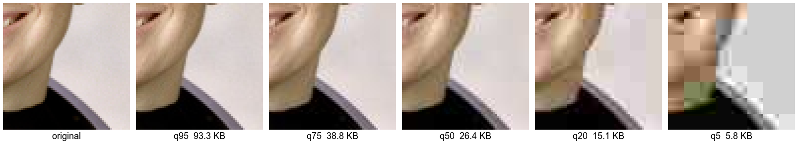
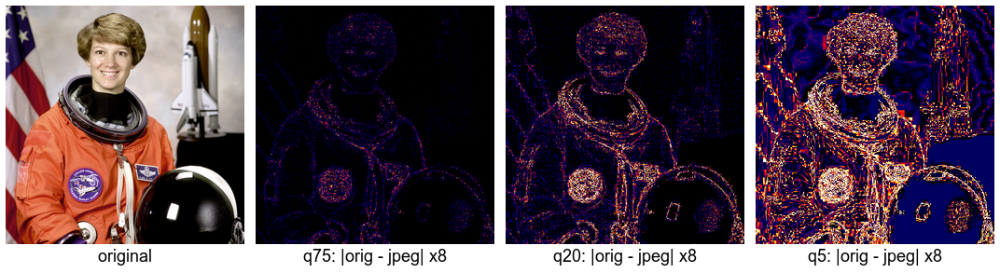
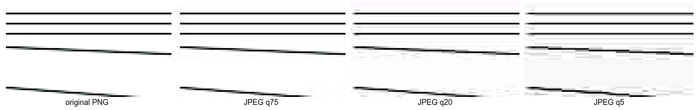
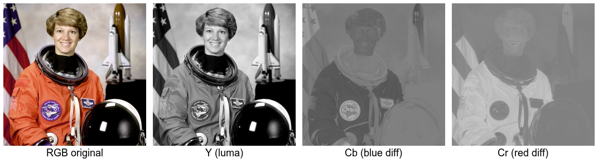
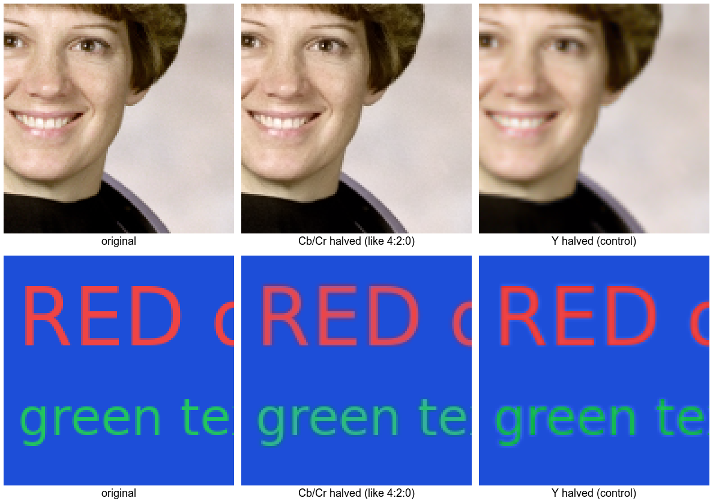
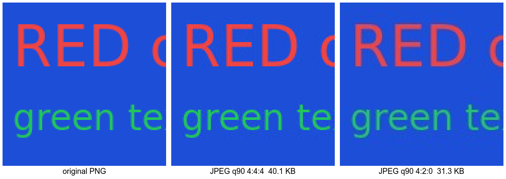
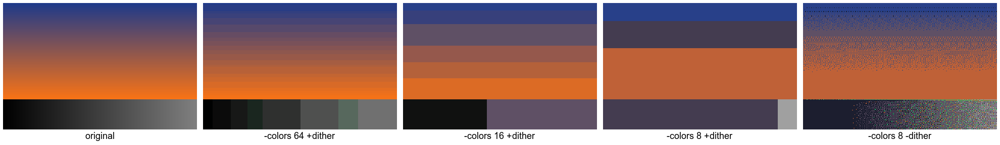
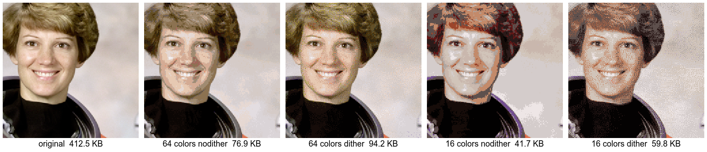

# image-compression-demo

用 ImageMagick 實際跑給你看：**圖片變小，是因為哪些資料不見了？**

這個 repo 是「圖片壓縮原理」文章與團隊分享的 demo。每個腳本只對應一個原理，跑完會在 `output/` 產出比較圖和數字表，文章和 slide 的圖都從這裡來。

## 快速開始

```bash
# macOS
brew install imagemagick

git clone <this-repo>
cd image-compression-demo
chmod +x scripts/*.sh   # 第一次執行前
./scripts/run_all.sh
```

跑完之後：

- `output/*.png`：比較圖（下面 README 引用的就是這些）
- `output/RESULTS.md`：所有檔案大小、壓縮比、PSNR 的彙整表

腳本同時支援 ImageMagick 7（`magick`）和 ImageMagick 6（`convert`）。

## 測試圖片

| 檔案 | 內容 | 用途 |
|---|---|---|
| `images/original/photo.png` | NASA 太空人照（公有領域，取自 scikit-image 範例圖），512×512 | 代表「照片」：顏色多、邊緣柔和 |
| `images/original/graphic.png` | 由 `scripts/00_make_test_images.sh` 產生：漸層、藍底紅字、細線、小字 | 代表「截圖 / 圖表 / UI」：顏色少、邊緣銳利 |

這兩張圖刻意選得很不一樣，因為**同一個參數對這兩種圖的效果常常相反**。想換成自己的圖，用同樣的檔名放進 `images/original/` 後重跑即可（裁切座標是照 512×512 設計的）。

> 名詞：**PSNR**（峰值訊噪比）用來量化「壓完後和原圖差多少」，單位 dB，越高越像原圖。一般來說 40 dB 以上肉眼很難分辨，30 dB 以下開始看得出瑕疵。

---

## Demo 01：`-quality` — 量化掉高頻細節

```bash
./scripts/01_quality_compare.sh
```

**一句話原理**：JPEG 把圖切成 8×8 區塊、用 DCT 轉成「頻率」，再把每個係數除以量化表、四捨五入。`-quality` 越低，量化表的數字越大，越多高頻（細節）係數變成 0，檔案越小。

核心指令：

```bash
magick photo.png -strip -sampling-factor 4:2:0 -quality 20 photo_q20.jpg
```

**放大看同一區域**：quality 越低，越看得到一格格 8×8 的方塊，區塊內部的細節被抹平。



**差異熱區圖**（`|原圖 − JPEG|` 放大 8 倍，越亮代表丟越多）：被丟掉的資料集中在**邊緣和紋理**，大片平滑的背景幾乎沒損失，因為那裡本來就沒有高頻。



**文字與細線**：銳利邊緣需要很多高頻係數才能表現，量化後邊緣旁邊出現雜點（振鈴 ringing / 蚊噪 mosquito noise）。



| 圖片 | 設定 | 檔案大小 | 相對無失真 PNG | PSNR |
|---|---|---:|---:|---:|
| photo | 無失真 PNG | 412.5 KB | 100% | — |
| photo | -quality 95 | 93.3 KB | 22.6% | 38.28 dB |
| photo | -quality 75 | 38.8 KB | 9.4% | 33.98 dB |
| photo | -quality 20 | 15.1 KB | 3.6% | 29.30 dB |
| graphic | 無失真 PNG | 17.5 KB | 100% | — |
| graphic | -quality 95 | **41.0 KB** | **234.5%** | 32.75 dB |
| graphic | -quality 75 | 22.6 KB | 129.3% | 31.53 dB |

> 💡 **重點**：照片轉 JPEG q75 只剩 9%；但 graphic 轉 JPEG q95 反而**是 PNG 的 2.3 倍大、畫質還變差**。顏色少、邊緣銳利的圖不適合 JPEG。

---

## Demo 02：`-sampling-factor` — 丟掉人眼看不到的顏色細節

```bash
./scripts/02_chroma_subsampling.sh
```

**一句話原理**：JPEG 先把 RGB 轉成 YCbCr（亮度 + 兩個色差）。人眼對亮度細節敏感、對顏色細節遲鈍，所以 4:2:0 讓每 2×2 個像素共用一組 Cb/Cr，原始資料量直接從每像素 3 個值變成 1.5 個。

**拆開來看**：Y 就是一張完整的黑白照片，細節全在這裡；Cb、Cr 幾乎是一片模糊的色塊。

```bash
magick photo.png -colorspace YCbCr -separate photo_ycbcr_%d.png
```



**手動模擬**：只把 Cb/Cr 縮成一半再放大（中間欄），照片幾乎看不出差別；同樣只縮 Y（右欄、對照組）就明顯變糊。但在**藍底紅字**上，顏色會溢出到字的外面。



**真正的 JPEG**：同樣 `-quality 90`，只換 `-sampling-factor`：

```bash
magick graphic.png -quality 90 -sampling-factor 4:4:4 graphic_444.jpg
magick graphic.png -quality 90 -sampling-factor 4:2:0 graphic_420.jpg
```



| 圖片 | sampling-factor | 每像素樣本數 | 檔案大小 | 相對 4:4:4 | PSNR |
|---|---|---:|---:|---:|---:|
| photo | 4:4:4 | 3 | 82.3 KB | 100% | 38.61 dB |
| photo | 4:2:0 | 1.5 | 65.0 KB | 79.0% | 36.64 dB |
| graphic | 4:4:4 | 3 | 40.1 KB | 100% | 43.15 dB |
| graphic | 4:2:0 | 1.5 | 31.3 KB | 78.1% | **32.53 dB** |

> 💡 **重點**：兩張圖都省了約 21%，但照片的 PSNR 只掉 2 dB，graphic 掉了超過 10 dB。ImageMagick 在 `-quality` < 90 時預設用 4:2:0，≥ 90 時用 4:4:4。

---

## Demo 03：`-colors` — 把顏色合併，讓 PNG 更好壓

```bash
./scripts/03_color_quantization.sh
```

**一句話原理**：PNG 本身是無失真的（濾波 + Deflate）。要讓它變小，可以先用 `-colors N` 把顏色合併成 N 種、存成調色盤 PNG（每像素只存 1 個索引，不再是 24 bit 的 RGB），重複的位元組變多，Deflate 就更好壓。這一步是**有失真**的。

```bash
magick photo.png +dither -colors 16 PNG8:photo_c16.png
magick photo.png -dither FloydSteinberg -colors 16 +dither PNG8:photo_c16_dither.png
```

> ⚠️ 第二行最後的 `+dither` 不能省。ImageMagick 7 寫 PNG8 時會再量化一次，如果 dither 還開著，會再疊一層雜點，最後顏色數超過你指定的 N。

**漸層的色帶（banding）**：顏色不夠時，平滑漸層會變成一階一階。`-dither` 用雜點混出中間色，看起來比較順。



**照片**：顏色越少越像海報。



| 圖片 | 設定 | 實際顏色數 | 檔案大小 | 相對無失真 PNG |
|---|---|---:|---:|---:|
| photo | 無失真 PNG | 113,382 | 412.5 KB | 100% |
| photo | +dither -colors 256 | 256 | 132.3 KB | 32.1% |
| photo | +dither -colors 16 | 16 | 41.7 KB | 10.1% |
| photo | -dither -colors 16 | 16 | 59.8 KB | 14.5% |
| graphic | 無失真 PNG | 920 | 17.5 KB | 100% |
| graphic | +dither -colors 64 | 54 | 5.3 KB | 30.4% |
| graphic | -dither -colors 64 | 52 | 11.5 KB | 65.7% |

> 💡 **重點**：dither 看起來比較好，但雜點破壞了重複的規律，Deflate 比較難壓，檔案明顯變大。graphic 原本只有 920 色，量化到 64 色幾乎看不出差別、檔案卻只剩 30%。

---

## ImageMagick 參數 ↔ 丟掉了什麼

| 參數 | 格式 | 丟掉的資料 | 最受影響的圖 |
|---|---|---|---|
| `-quality N` | JPEG | DCT 高頻係數（細節、銳利邊緣） | 文字、線條、截圖 |
| `-sampling-factor 4:2:0` | JPEG | 3/4 的色彩解析度（Cb/Cr） | 鮮豔色塊相鄰的邊緣 |
| `-colors N` | PNG8 / GIF | 顏色種類（調色盤之外的顏色） | 漸層、照片 |
| `-dither` / `+dither` | PNG8 / GIF | 不丟資料，是用雜點換視覺平滑（代價是檔案變大） | — |
| `-strip` | 全部 | EXIF、ICC profile、縮圖等 metadata（不影響像素） | 相機拍的照片 |
| `-define png:compression-level=9` | PNG | 不丟資料，只是更努力壓（比較慢） | — |

## Repo 結構

```
image-compression-demo/
├── README.md
├── images/original/          # 測試圖
├── scripts/
│   ├── _common.sh            # 共用函式（偵測 IM6/IM7、PSNR、熱區圖、放大裁切）
│   ├── 00_make_test_images.sh
│   ├── 01_quality_compare.sh
│   ├── 02_chroma_subsampling.sh
│   ├── 03_color_quantization.sh
│   └── run_all.sh
├── output/                   # 比較圖 + RESULTS.md（中間產物不進 git）
└── docs/article-outline.md   # 文章大綱
```

> README 裡的數字是用 ImageMagick 7.1.2 跑出來的；不同版本或 libjpeg 實作會有些微差異，以你自己跑出的 `output/RESULTS.md` 為準。
